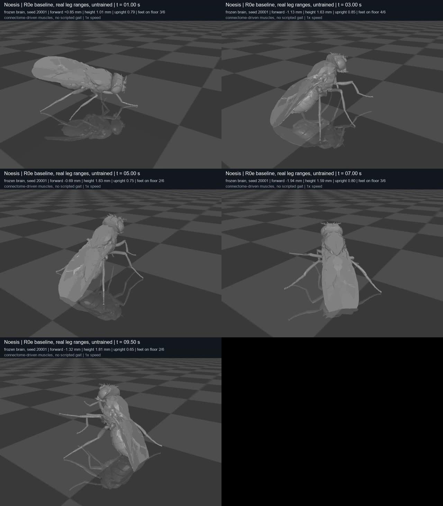

# ניתוח: שימוש ברגליים, טווח תנועה והתקדמות האימון (26.11.2026)

הניתוח מבוסס רק על נתונים קיימים: הערכות על זרעים 20001–20003 (5 שניות כל אחד), audits של הרגליים, והסרטונים. לא הורץ שום דבר חדש, ו-R5 לא הופרע.

## 1. ההתקדמות לאורך הסבבים

| סבב | רגליים | שיטה | עמידה (ממוצע 3 זרעים) | זקיפות | קדימה mm | הרגל החלשה (תמיכה פרושה) | צעדים מינ' לרגל | תוצאה |
|---|---|---|---|---|---|---|---|---|
| R0 / R0d | טבעיות | ללא אימון | 0.905 | 0.874 | +1.05 | RF 0.07–0.32 | 1 | בסיס |
| R1b | טבעיות | ES, 2 זרעים | **0.931** | 0.889 | +0.63 | RF 0.11–0.25 | 1 | השיפור הכי טוב עד כה |
| R2b | טבעיות | CMA-ES, 2 זרעים | 0.789 | – | – | – | – | התאמת-יתר; נפל בזרע 20002 |
| R3 | טבעיות | ES מ-R1b | 0.889 | 0.899 | +0.02 | – | **2** (ראשון שעבר "כל 6 הרגליים ≥2 צעדים") | נסיגה בעמידה |
| R4 | טבעיות | ES, 4 זרעים | (לא הוערך) | | | | | שטוח לגמרי ב-7 דורות |
| R0e | **אמיתיות** | ללא אימון | 0.633 | 0.803 | +0.32 | LM 0.06–0.14 | 1 | בסיס חדש |
| R5 | אמיתיות | ES מ-R1b, 4 זרעים | רץ עכשיו | | | | | |

שורה תחתונה: על הרגליים הטבעיות האימון הוסיף לכל היותר +0.026 עמידה (R1b), ואחר כך נתקע. אף שער עדיין לא עבר.

## 2. פירוק לפי רגל

תמיכה פרושה = חלק מהזמן שבו הרגל דורכת על הרצפה כשהיא פרושה (≥70% מהטווח). הטווח בכל תא הוא על פני 3 הזרעים.

| רגל | טבעיות (R0) | R1b | אמיתיות (R0e) | אורך צעד mm טבעיות → אמיתיות | צעדים טבעיות → אמיתיות |
|---|---|---|---|---|---|
| LF קדמית שמאל | 0.58–0.82 | 0.46–0.67 | 0.62–0.72 | 0.8–1.1 → **1.5–1.8** | 1–5 → 3–4 |
| LM אמצעית שמאל | 0.14–0.31 | 0.30–0.39 | **0.06–0.14** | 0.7–1.1 → 0.9–1.2 | 4–7 → 1–5 |
| LH אחורית שמאל | 0.36–0.71 | 0.51–0.70 | 0.45–0.56 | 1.3–1.8 → **1.6–2.1** | 2–8 → 4–6 |
| RF קדמית ימין | **0.07–0.32** | **0.11–0.25** | 0.20–0.27 | 0.4 → 0.6–0.7 | 2–4 → 2–5 |
| RM אמצעית ימין | 0.30–0.63 | 0.29–0.64 | 0.35–0.56 | 0.7–1.3 → **1.3–1.9** | 2–8 → 4–7 |
| RH אחורית ימין | 0.30–0.76 | 0.25–0.66 | 0.45–0.73 | 0.5–0.7 → 0.9–1.0 | 4 → 2–6 |

### טווח תנועה בפועל (סטיית תקן של זווית המפרק, rad; זרע 20001, 3 שניות, מוח לא מאומן)

| רגל | טבעיות | אמיתיות | שינוי |
|---|---|---|---|
| LF | 0.093 | 0.152 | +63% |
| LM | 0.146 | 0.146 | 0 |
| LH | 0.185 | 0.202 | +9% |
| RF | 0.117 | 0.171 | +46% (Femur מ-0.17 ל-0.34) |
| RM | 0.116 | 0.144 | +24% |
| RH | 0.125 | 0.121 | ‎−3% |

- אף מפרק לא נוגע בגבול הטווח (`cmd_at_limit` = 0 בכל 42 המפרקים, בכל הגרסאות). כלומר הגבולות עצמם לא מגבילים את הזבוב. מה שמשנה בפועל זו **תנוחת המנוחה**: היא קובעת לאן המוח "דוחף" ממנה.
- מפרקי **Coxa_roll של הרגליים האמצעיות והאחורית הימנית** כמעט לא זזים בשום גרסה (0.03–0.08 rad), לעומת 0.24–0.27 ב-LH. זה מאפיין של המוח (הנוירונים המוטוריים של המפרק הזה כמעט שקטים), לא של הגוף. זו הסיבה העיקרית ש-RH נראה "מקל קשיח" ו-LM לא תומך.

## 3. מה רואים בסרטון של R0e

- **t=1s:** הזבוב עומד נמוך (1.0 mm), 3 רגליים על הרצפה, וכבר מתחיל לנטות אחורה.
- **t=3–5s:** הזבוב **מתרומם על הבטן**. הראש עולה, הבטן יורדת לרצפה, ורק 2–4 רגליים נוגעות. הגובה הנמדד (1.6–1.8 mm) הוא החזה שהתרומם, לא עמידה גבוהה.
- **t=7s:** מבט מאחור. הרגליים פרושות לצדדים בקשת רחבה, יפה ודומה לזבוב אמיתי, אבל הן לא נושאות משקל.
- **t=9.5s:** זקיפות 0.65, הזבוב מסתובב, ורק 2 מתוך 6 רגליים על הרצפה.

המסקנה: הרגליים החדשות זזות כמו של זבוב, אבל המוח (שאומן במקור על התנוחה הישנה) לא מייצב את המרכז. גוף הזבוב נוטה אחורה וצונח על הבטן.

## 4. לקחים

1. **האימון על הרגליים הטבעיות הגיע לתקרה.** ES שיפר מעט (R1b), ושלושה סבבים אחר כך לא הוסיפו כלום. הרווחים נשארו בטווח ±12%, למרות שמותר ±50%. החיפוש מקומי מדי ולא מוצא כיוון טוב יותר. גם בלי תיקון הרגליים היה צריך לשנות משהו.
2. **זרעים קבועים חיוניים, אבל 2 זה מעט מדי.** כשהזרע השתנה בכל דור (R1), הבחירה הייתה רעש. עם 2 זרעים קבועים התקבלה התאמת-יתר (R2b, R3: ציון אימון עולה ועמידה על זרעים חדשים יורדת). 4 זרעים (R4) נתנו אות יציב יותר, אבל שטוח.
3. **ספירת "מגעים" מטעה, צריך צעדים אמיתיים.** 30–80 מגעים לרגל התבררו כרעידות מגע. הצעדים המסוננים (נדנוד ≥40ms ואחריו דריכה ≥40ms) מראים שגם המוח הלא מאומן מייצר צעדים אמיתיים בכל הרגליים. הקצב קיים, חסר התיאום.
4. **הבעיה ברגל האחורית לא הייתה מיפוי.** לכל 391 הנוירונים המוטוריים יש צד, ואף מפרק לא נתקע בגבול. הבעיה היא שילוב של תנוחת מנוחה לא נכונה ושל מפרקי roll שקטים כמעט לגמרי.
5. **מודל "שריר לפי גודל המאגר" (R0c) מזיק.** העמידה ירדה ל-0.34, והזבוב התרומם 40°. לא אומץ.
6. **רגליים אמיתיות מגדילות צעדים פי 1.5 ומאזנות את הצעדים, אבל העמידה נופלת ל-0.63.** חלק מהנפילה מצטבר לאט: בסרטון של 10 שניות העמידה היא 0.37, לעומת 0.50 ב-5 השניות הראשונות. לכן **פרקי אימון של 1.5 שניות עלולים לפספס את הנפילה**. זה הסיכון המרכזי ל-R5.
7. **תשתית:** המחשב נרדם בלילה (R3 בזבז 10 שעות), ותקציב הזמן נספר גם בזמן שינה. כדאי להגדיר שינה = אף פעם בזמן אימון.

## 5. מה הלאה (לפי תוצאות R5)

- **אם R5 משפר עמידה על הרגליים האמיתיות:** להמשיך באותו כיוון ולעבור לשלב ההליכה.
- **אם R5 שטוח:**
  - להאריך את פרקי האימון ל-3 שניות, כדי לתפוס את הצניחה המאוחרת.
  - להוסיף לציון העמידה רכיב של זקיפות ושל גובה הבטן מהרצפה.
  - להגדיל את sigma ל-0.1, כי הרווחים כמעט לא זזים.
- **בכל מקרה:**
  - לעקוב אחרי LM (התמיכה הכי חלשה ברגליים האמיתיות) ואחרי RF.
  - קבוצה ייעודית לנוירונים של Coxa_roll ברגליים האמצעיות יכולה לתת לאימון ידית ישירה על המפרק השקט.
