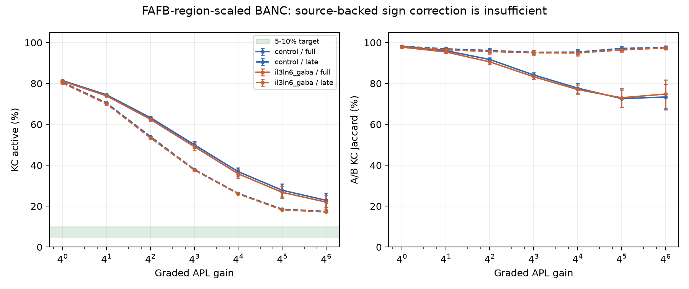

# Olfactory specificity on the FAFB-scaled brain

## Predictions recorded before outcome assays (2026-10-13)

Base: `feature/brain-rescale`, `493c62ecfd847fde6235c86e9ff65737f4bb08b1` (PR #11).
Only region scaling is used; no KC class-pair scaling is stacked on it.

1. Corrected weights will not necessarily improve specificity: stronger lateral
   excitation can recruit more off-target PNs as well as strengthening the
   intended ORN -> PN pathway.
2. Increasing graded APL gain should reduce KC firing/active fraction, but need
   not decorrelate non-specific PN input. Sparse silent output is not success.
3. An onset-inclusive active-cell count can retain an inhibition-latency floor;
   late-window sparseness may differ. Both windows will be reported.
4. The existence of excitatory AL LNs is established biology, so converting all
   cholinergic LNs to inhibitory would be unjustified. Type-level NT changes
   require specific evidence, not improvement of the assay's score.

Protocol: five fixed A/B pairs, five glomeruli per odour, disjoint A/B within
each pair; three simulation seeds. Pair definitions are independent of simulation
seeds. Fresh brain and APL state per odour, no background and no learning;
80 Hz ORN Poisson drive with weight 400, dt 0.5 ms, adaptation 1 mV, 600 ms total.
Report 0–600 ms and 100–600 ms windows, active = at least one spike in the window.
Report Jaccard A/B overlap, its chance expectation, and population-rate cosine.
PNs with a known uniglomerular label are reported separately from multiglomerular
and unknown PNs, which cannot safely be called "off-target".

Controls: unchanged region-scaled spiking APL, zero-input silence, deterministic
no-change repeat, and one change per treatment. Graded APL gain is the sole
calibration parameter. Any further treatments and their predictions are recorded
here before their runs. Raw counts and region-corrected LN->PN weights are both
audited; raw subthreshold pathway weights are not added to corrected weights.

Results are reported below.

## Additional predictions recorded before their runs

- **Numerical refinement:** update graded APL every neural step (0.5 ms) instead
  of every 5 ms, holding gain 1024, tau, weights, stimulus and seeds fixed. APL is
  non-spiking with continuous release (Amin et al. 2020,
  https://doi.org/10.7554/eLife.56954); batching its feedback creates an artificial
  delay. Predict a smaller onset-inclusive KC activity floor. This is a timestep
  convergence test, not a new inhibitory-strength fit or NT override. Compare
  against the 5 ms gain-1024 control across the same five pairs and three seeds.
- **Causal diagnostic, not a recommended fix:** block only positive AL-LN -> PN
  connections, preserving every other edge and sign. Predict lower off-target PN
  recruitment if this pathway explains broadcast. Excitatory LNs are real
  (Shang et al. 2007, https://doi.org/10.1016/j.cell.2006.12.034), so wholesale
  removal must not be presented as a biologically corrected healthy brain.
  Run only after the gain curve, against a same-gain no-change control.

Calibration selection rule (recorded after the spiking/gain-1 interim results,
before any target-range gain result): choose the tested gain closest to 7.5%
mean KC activity on pairs 0–2, only if that mean is within 5–10%. Keep pairs 3–4
as held-out odours and report their spreads separately. Onset-inclusive activity
is primary; late-window calibration is a separately labelled secondary analysis.
Do not select an incomplete condition or interpret zero activity as specificity.


## Prediction before the il3LN6 correction assay

Salman et al. (2026), Fig. 2I-L, report il3LN6 GABA immunolabeling and absence
of ChAT/vGlut: https://doi.org/10.1152/jn.00571.2025. BANC also labels both
il3LN6 cells verified GABA, despite predicting the left cell (720575941478599454)
ACh; the right cell is already predicted GABA. Correct this type only. Predict
less broad PN recruitment and lower KC A/B overlap, without requiring removal
of biologically valid cholinergic LNs. Whether it reaches 5–10% KC activity is
unknown; recalibrate the graded gain rather than assume the old gain transfers.
Freeze PR #11's APL-only overrides for matched no-change controls, independent
of the new global override. All other signs, magnitudes and topology stay fixed.

## Results (2026-10-13–14)

The region-scaled brain remains non-specific. The evidence supports one NT
correction, `il3LN6 -> GABA`, but it does not restore a specific odour code.
No tested graded APL gain reaches 5–10% KC activity. Broad LN ablation is a
causal diagnostic, not a recommended biological correction.

### Sampling and controls

Each condition contains five pairs × three seeds × two odours = 30 individual
trials; overlap has 15 paired observations. All 50 glomeruli are globally
disjoint. Pair-generation seed: 20261013; simulation seeds: 0, 1, 2. Pairs 0–2
calibrate gains; pairs 3–4 are held out. No odours were selected using outcomes.
SD is descriptive sample SD, not a confidence interval or independent biological
replication. Seeds and paired odours are correlated.

The graph has 158,262 annotated neurons, 2,642,964 retained corrected pairs,
4,139 KCs, 699 PNs, 429 AL LNs and two APLs. AL region factor: 1.6190. APL tau:
10 ms. No weak-edge restoration, background, learning or KC class-pair rescaling
is applied. Private caches use input hashes and factors; main data is read-only.

PN on-target means explicitly labelled uniglomerular PNs matching driven ORN
glomeruli. Off-target uniglomerular PNs exclude ambiguous/multiglomerular labels;
the legacy off-all metric includes them. There are 275 explicitly labelled
uniglomerular PNs and 424 unassigned PNs. Mean rates include silent cells.
Active means at least one spike; CSVs also report the >=5 Hz fraction. Jaccard
is intersection/union, silent unions undefined. Chance Jaccard assumes independent
activity at the observed fractions; rate-vector cosine is retained.

Zero-input runs were silent for all three seeds with spiking APL and gain 1024.
Fresh seeded repeats reproduced PN/KC counts exactly. After adding the global
override, restoring the frozen APL-only control reproduced the original
gain-1024 trial exactly. Corrected-sign silence/repeat checks also passed.
Frozen signs prevent the override or cached signs contaminating controls.

### Structural limit and negative results

980/4,139 KCs (23.68%) have **zero APL input even before thresholding**: 493 KCg,
461 KCab, 13 KCapbp and 13 generic KC. Region scaling changes magnitudes, not
missing topology. All 5,177 FAFB KCs in the supplied type table have raw APL
input: mean 28.40 synapses/KC versus BANC 5.03.

At baseline gain 4096, **100% of late-active KCs across all 30 trials lack APL
input**. Full-window uncovered fractions average 78.42% [47.61%, 87.02%]. This
identifies a direct-inhibition floor for GradedAPL; raising gain cannot directly
inhibit those cells. It does not justify inventing missing BANC connections.

The gain-1024 positive AL-LN -> PN ablation greatly reduces off-target PN
recruitment and KC overlap, demonstrating a causal broadcast route in this
model. It also lowers intended PN rates and sometimes puts KC activity below
target. It removes all model-positive LN outputs onto PNs, including OCT/SER,
rather than one type or a measured receptor mechanism. Cholinergic LNs are real,
so this is **not** the proposed healthy-brain correction.

### Literature comparison and the sole added NT override

- **Keep cholinergic LNs:** Shang et al. established lateral excitation
  ([Cell 2007](https://doi.org/10.1016/j.cell.2006.12.034)). Eckstein et al.
  discuss mixed AL transmitter predictions and validated cholinergic populations
  ([Cell 2024](https://doi.org/10.1016/j.cell.2024.03.016)). Prediction disagreement
  does not license blanket reassignment. The dominant lLN1_bc ACh group has
  32,951 raw PN synapses and stays unchanged.
- **Keep glutamate inhibitory:** Liu & Wilson demonstrated inhibitory LN effects
  mediated by GluClα ([PNAS 2013](https://doi.org/10.1073/pnas.1220560110)). This
  supports the existing sign, not identical dynamics for inhibitory transmitters.
- **Only added override: il3LN6 -> GABA.** Salman et al. show GABA-positive,
  ChAT/vGlut-negative il3LN6
  ([J Neurophysiol 2026, Fig. 2I–L](https://doi.org/10.1152/jn.00571.2025));
  Taisz et al. describe its contralateral inhibitory pathway
  ([Cell 2023](https://doi.org/10.1016/j.cell.2023.04.038)). Both BANC cells carry
  verified GABA labels. The left (720575941478599454, prediction confidence 0.49) is predicted ACh and contributes 1,802 raw /
  2,753.07 corrected LN -> PN weight; the right is already GABA (1,180 / 1,804.78).
  The override changes the left cell's outgoing signs everywhere, preserving
  magnitudes; the right is unchanged. lLN2F_b and lLN2P groups already have the
  GABA signs supported by Salman et al. and remain unchanged. The citation is beside `NT_OVERRIDES`.
  Matched measurements show this is warranted but insufficient.
- **Unresolved predictions stay unchanged:** lLN2T_d's other-connectome prediction
  is not experimental verification; v2LN30 has GLUT/OCT disagreement; other types
  mix predictions and verified annotations. Monoamines retain the existing
  fast-positive assumption despite modulatory biology.

### Interpretation and limitations

The corrected brain amplifies off-target PN input. Pooled APL feedback cannot
decorrelate it or reach KCs absent from its output graph. The model lacks explicit
presynaptic GABA gain control and ORN -> PN depression; these are experimentally
supported candidates ([Olsen & Wilson 2008](https://doi.org/10.1038/nature06864),
[Kazama & Wilson 2008](https://doi.org/10.1016/j.neuron.2008.02.030)), not tested
explanations or implemented fixes here. APL inhibition is spatially localized
([Amin et al. 2020](https://doi.org/10.7554/eLife.56954)), whereas GradedAPL pools
one scalar. Further specificity claims require independently validated dynamics
or justified missing-connectivity mapping with matched controls. These synthetic
ORN ensembles and short windows do not establish natural odour decoding or behaviour.

### Reproduction

Run in an isolated worktree based on `feature/brain-rescale`, with read-only
main-checkout data and private outputs. PowerShell:

```powershell
$env:PYTHONPATH='src'
$py='C:/dev/venvs/noesis/Scripts/python.exe'
$data='<main checkout>/data'
& $py -m noesis.experiments.olfactory_specificity --data $data --output outputs/olfaction-corrected --workers 3
& $py -m noesis.experiments.olfactory_specificity --data $data --output outputs/olfaction-corrected --il3ln6-gaba --workers 3
& $py -m noesis.experiments.olfactory_specificity --data $data --output outputs/olfaction-corrected --gains 1024 --skip-spiking --ln-excitation-off --workers 3
& $py -m noesis.experiments.olfactory_specificity --data $data --output outputs/olfaction-fast-apl --gains 1024 --skip-spiking --feedback-ms 0.5 --workers 1
& $py -m ruff check --no-cache .
& $py -m pytest -q
```

The assay explicitly reconstructs PR #11's APL-only baseline even though normal
`load_cached` applies il3LN6's source-backed override. The flag adds exactly that
sign correction. Paired trials resume under an identical input/protocol manifest.
Per-neuron NPZs stay local under outputs. No protected source files or
`docs/findings.md` were modified. Numerical tables and the full LN inventory
follow; supporting CSVs retain unrounded observations.


## Numerical tables

Values are mean +/- sample SD [min, max]. Full = 0-600 ms; late = 100-600 ms. Rates are Hz; fractions and Jaccard are percent. Only complete 30-trial conditions appear. CSVs contain 15 distinct pair/seed overlap values, repeated on their A/B rows; do not count these as 30 overlaps. [Per-trial data](olfaction-results/measurements.csv), [inputs and protocol](olfaction-results/protocol.json), [controls](olfaction-results/controls.json), [corrected-sign controls](olfaction-results/controls-il3ln6_gaba.json), [frozen no-change verification](olfaction-results/post_override_no_change_control.json).

| Pair | A | B |
|---|---|---|
| 0 | DA4l, DL1, VA7l, VL1, VM7v | D, DP1l, VA3, VA4, VC1 |
| 1 | DC3, DM1, DM5, VA1d, VM1 | DC1, DL2d, DM4, VC5, VM7d |
| 2 | DM6, V, VA6, VL2p, VM2 | DA1, DL4, VA7m, VM4, VM6 |
| 3 | DA4m, DC2, DL3, VC2, VM5v | DA2, DA3, DL5, DM3, VM5d |
| 4 | DC4, DL2v, VA1v, VA5, VC4 | DP1m, VA2, VC3, VL2a, VM3 |

### Layer comparisons

| Treatment / APL | Window | PN on Hz | PN on active % | PN off-uniglomerular Hz | PN off active % | KC active % | KC A/B Jaccard % |
|---|---|---|---|---|---|---|---|
| control / spiking | full | 264.05 +/- 37.31 [196.49, 319.51] | 98.94 +/- 1.69 [95.65, 100.00] | 170.27 +/- 3.35 [165.65, 176.63] | 82.58 +/- 1.43 [80.56, 84.92] | 58.92 +/- 0.73 [57.84, 60.74] | 95.23 +/- 1.17 [93.40, 97.00] |
| control / spiking | late | 261.96 +/- 38.25 [192.21, 320.71] | 96.63 +/- 4.78 [84.62, 100.00] | 171.98 +/- 3.69 [166.88, 179.41] | 78.43 +/- 1.13 [76.52, 80.51] | 57.69 +/- 0.85 [56.41, 59.72] | 95.44 +/- 1.43 [93.19, 97.64] |
| control / 1024 | full | 266.56 +/- 37.74 [198.05, 321.18] | 99.48 +/- 1.39 [95.65, 100.00] | 175.43 +/- 3.39 [170.98, 182.09] | 83.78 +/- 1.53 [80.97, 86.35] | 27.79 +/- 3.19 [24.43, 38.39] | 72.60 +/- 4.25 [64.79, 79.76] |
| control / 1024 | late | 264.65 +/- 38.81 [193.52, 322.59] | 97.17 +/- 4.95 [84.62, 100.00] | 177.18 +/- 3.73 [172.33, 184.84] | 79.46 +/- 1.36 [76.92, 82.20] | 18.51 +/- 0.17 [18.24, 18.85] | 97.14 +/- 1.11 [94.84, 98.56] |
| il3ln6_gaba / spiking | full | 261.70 +/- 34.74 [195.40, 316.76] | 98.41 +/- 2.04 [94.59, 100.00] | 163.87 +/- 3.09 [159.50, 169.42] | 82.21 +/- 2.32 [77.78, 86.44] | 57.79 +/- 0.82 [56.70, 59.94] | 94.72 +/- 1.47 [92.52, 97.15] |
| il3ln6_gaba / spiking | late | 259.44 +/- 35.54 [190.83, 317.53] | 97.64 +/- 2.67 [92.31, 100.00] | 165.56 +/- 3.40 [160.50, 172.13] | 79.14 +/- 2.29 [75.00, 82.20] | 56.52 +/- 0.94 [55.30, 58.88] | 95.08 +/- 1.40 [93.00, 97.13] |
| il3ln6_gaba / 1024 | full | 264.21 +/- 35.31 [196.95, 319.02] | 98.86 +/- 1.78 [95.65, 100.00] | 168.93 +/- 3.05 [164.82, 174.61] | 83.54 +/- 2.29 [78.97, 87.71] | 26.77 +/- 2.97 [23.87, 37.40] | 73.01 +/- 4.64 [62.66, 78.79] |
| il3ln6_gaba / 1024 | late | 262.12 +/- 36.19 [192.41, 320.12] | 98.09 +/- 2.62 [92.31, 100.00] | 170.66 +/- 3.34 [166.00, 177.34] | 80.68 +/- 1.94 [76.98, 83.73] | 18.17 +/- 0.24 [17.90, 18.63] | 96.40 +/- 1.09 [94.27, 97.87] |
| ln_excitation_off / 1024 | full | 107.50 +/- 29.96 [65.13, 173.43] | 90.85 +/- 7.99 [75.00, 100.00] | 0.54 +/- 0.44 [0.00, 1.23] | 1.72 +/- 0.99 [0.00, 3.57] | 6.08 +/- 1.91 [3.50, 9.01] | 12.74 +/- 3.07 [8.48, 16.89] |
| ln_excitation_off / 1024 | late | 98.19 +/- 29.62 [56.00, 167.29] | 81.59 +/- 10.06 [60.71, 96.55] | 0.45 +/- 0.40 [0.00, 1.14] | 0.93 +/- 0.59 [0.00, 1.63] | 4.40 +/- 1.34 [2.80, 7.01] | 13.96 +/- 4.10 [7.99, 19.67] |

Legacy off-all baseline spiking late activity: 67.17 +/- 0.62 [66.12, 68.49]%. Explicitly uniglomerular off-target PNs are more active, so the denominator does not rescue specificity. Remaining layer rates and all-PN overlap are in the CSV.

### Gain curves



| NT condition | Gain | KC full active % | KC late active % | KC late Jaccard % | Late chance Jaccard % |
|---|---|---|---|---|---|
| control | 1 | 81.41 +/- 0.33 [80.91, 82.02] | 80.63 +/- 0.39 [80.12, 81.52] | 98.19 +/- 0.63 [97.00, 98.95] | 67.54 +/- 0.47 [66.86, 68.39] |
| control | 4 | 74.47 +/- 0.34 [73.76, 75.21] | 70.48 +/- 0.41 [69.97, 71.39] | 96.92 +/- 0.87 [95.19, 97.99] | 54.42 +/- 0.40 [53.91, 55.10] |
| control | 16 | 63.30 +/- 0.75 [61.78, 64.58] | 54.06 +/- 0.23 [53.71, 54.51] | 96.12 +/- 1.13 [94.32, 97.78] | 37.04 +/- 0.19 [36.76, 37.35] |
| control | 64 | 50.03 +/- 1.56 [47.60, 53.15] | 37.95 +/- 0.32 [37.45, 38.54] | 95.23 +/- 1.19 [92.94, 97.14] | 23.42 +/- 0.20 [23.07, 23.68] |
| control | 256 | 36.86 +/- 1.96 [34.07, 41.73] | 26.26 +/- 0.17 [25.92, 26.62] | 95.33 +/- 1.34 [93.00, 97.81] | 15.12 +/- 0.07 [14.96, 15.21] |
| control | 1024 | 27.79 +/- 3.19 [24.43, 38.39] | 18.51 +/- 0.17 [18.24, 18.85] | 97.14 +/- 1.11 [94.84, 98.56] | 10.20 +/- 0.09 [10.06, 10.34] |
| control | 4096 | 22.83 +/- 3.56 [20.29, 36.94] | 17.41 +/- 0.13 [17.23, 17.66] | 97.58 +/- 0.85 [96.09, 98.61] | 9.54 +/- 0.07 [9.45, 9.64] |
| il3ln6_gaba | 1 | 81.12 +/- 0.36 [80.36, 81.81] | 80.25 +/- 0.42 [79.56, 81.15] | 97.99 +/- 0.46 [97.34, 98.77] | 67.01 +/- 0.46 [66.34, 67.76] |
| il3ln6_gaba | 4 | 73.97 +/- 0.41 [73.28, 74.56] | 70.03 +/- 0.59 [69.29, 71.06] | 96.48 +/- 0.66 [95.39, 97.42] | 53.88 +/- 0.59 [53.06, 54.83] |
| il3ln6_gaba | 16 | 62.48 +/- 0.89 [60.84, 64.17] | 53.42 +/- 0.38 [52.94, 54.05] | 95.60 +/- 1.11 [93.73, 97.22] | 36.45 +/- 0.26 [36.12, 36.78] |
| il3ln6_gaba | 64 | 49.11 +/- 1.91 [46.58, 53.03] | 37.69 +/- 0.36 [37.13, 38.39] | 95.03 +/- 1.17 [93.36, 97.30] | 23.22 +/- 0.26 [22.80, 23.66] |
| il3ln6_gaba | 256 | 35.81 +/- 2.03 [33.20, 41.00] | 26.00 +/- 0.17 [25.76, 26.36] | 94.89 +/- 1.32 [93.27, 97.32] | 14.95 +/- 0.09 [14.80, 15.07] |
| il3ln6_gaba | 1024 | 26.77 +/- 2.97 [23.87, 37.40] | 18.17 +/- 0.24 [17.90, 18.63] | 96.40 +/- 1.09 [94.27, 97.87] | 9.99 +/- 0.12 [9.83, 10.18] |
| il3ln6_gaba | 4096 | 21.97 +/- 3.40 [19.79, 36.10] | 17.19 +/- 0.18 [16.96, 17.49] | 97.35 +/- 0.83 [96.17, 99.01] | 9.40 +/- 0.09 [9.27, 9.51] |

No complete gain has calibration-pair mean within 5-10% in either window: selected_gain is null. [Training and held-out spreads](olfaction-results/calibration.json). This is failed calibration, not a recommendation to use the largest gain.

At gain 1024, updating feedback every 0.5 ms rather than 5 ms gives late KC activity 18.49 +/- 0.16 [18.22, 18.80]% and Jaccard 96.95 +/- 1.29 [94.11, 98.82]%. This numerical refinement does not recover specificity. [Both-window paired data](olfaction-results/fast-feedback-measurements.csv). [Coverage audit](olfaction-results/apl_coverage.json).

### AL local-neuron inventory

Raw totals reproduce 89,109 model-positive versus 81,623 model-negative LN -> PN synapses. Raw counts and retained corrected magnitudes are distinct: scaling precedes thresholding.

| Predicted NT | Neurons | Raw PN synapses | Corrected retained magnitude |
|---|---|---|---|
| ACH | 104 | 83663 | 128085.48 |
| GABA | 147 | 49829 | 75844.48 |
| GLUT | 162 | 31794 | 49449.75 |
| OCT | 3 | 4081 | 6525.85 |
| SER | 13 | 1365 | 2080.01 |

Effective signs below are PR #11 baseline; only il3LN6/ACh becomes negative in the correction. Corrected magnitudes are unsigned. [CSV including retained pair counts and hemilineages](olfaction-results/al_local_neuron_audit.csv).

| LN type | Predicted NT | Sign | Neurons | Raw PN synapses | Corrected retained magnitude |
|---|---|---|---|---|---|
| unknown | ACH | +1 | 1 | 92 | 120.40 |
| ALBN1 | GLUT | -1 | 2 | 1918 | 3014.19 |
| CB1013 | GLUT | -1 | 5 | 160 | 235.35 |
| CB1013 | SER | +1 | 1 | 25 | 25.90 |
| CB1048 | GLUT | -1 | 4 | 691 | 1060.46 |
| CB1048 | SER | +1 | 1 | 152 | 216.95 |
| CB1132 | GABA | -1 | 3 | 477 | 636.28 |
| CB1141 | GABA | -1 | 11 | 278 | 357.80 |
| CB1266 | GLUT | -1 | 1 | 254 | 372.38 |
| CB1473 | GABA | -1 | 2 | 232 | 312.47 |
| CB1545 | GLUT | -1 | 5 | 986 | 1547.79 |
| CB1545 | SER | +1 | 2 | 371 | 586.09 |
| CB1546 | GABA | -1 | 8 | 1334 | 1854.38 |
| CB1668 | GLUT | -1 | 10 | 924 | 1423.12 |
| CB1673 | GLUT | -1 | 4 | 51 | 58.28 |
| CB1676 | GLUT | -1 | 3 | 228 | 291.42 |
| CB1686 | GABA | -1 | 5 | 925 | 1309.13 |
| CB1824 | GABA | -1 | 5 | 120 | 140.85 |
| CB1824 | OCT | +1 | 1 | 3 | 0.00 |
| CB2345 | GLUT | -1 | 2 | 82 | 113.33 |
| CB2471 | GABA | -1 | 5 | 554 | 780.37 |
| CB2504 | GABA | -1 | 2 | 243 | 364.28 |
| CB2527 | GLUT | -1 | 7 | 343 | 511.78 |
| CB2569 | GLUT | -1 | 5 | 671 | 1003.79 |
| CB2571 | GLUT | -1 | 4 | 181 | 278.47 |
| CB2571 | SER | +1 | 1 | 51 | 82.57 |
| CB2661 | GLUT | -1 | 3 | 245 | 338.38 |
| CB2845 | GABA | -1 | 4 | 138 | 189.43 |
| CB2908 | GABA | -1 | 5 | 880 | 1293.60 |
| CB2908 | OCT | +1 | 1 | 178 | 273.61 |
| CB3007 | ACH | +1 | 1 | 8 | 8.10 |
| CB3007 | GABA | -1 | 9 | 434 | 532.66 |
| CB3172 | GLUT | -1 | 2 | 111 | 145.71 |
| CB3202 | GABA | -1 | 5 | 1058 | 1562.36 |
| CB3326 | GLUT | -1 | 5 | 91 | 113.33 |
| CB3417 | GLUT | -1 | 8 | 346 | 453.33 |
| CB3575 | GLUT | -1 | 1 | 26 | 32.38 |
| CB3633 | GLUT | -1 | 3 | 68 | 76.09 |
| CB3679 | ACH | +1 | 1 | 197 | 241.23 |
| CB3679 | GABA | -1 | 1 | 139 | 247.23 |
| LN60a | GABA | -1 | 2 | 2622 | 4063.60 |
| LN60b | GABA | -1 | 2 | 2653 | 4115.56 |
| il3LN6 | ACH | +1 | 1 | 1802 | 2753.07 |
| il3LN6 | GABA | -1 | 1 | 1180 | 1804.78 |
| l2LN19 | GABA | -1 | 4 | 1265 | 1950.92 |
| l2LN20 | GABA | -1 | 4 | 1190 | 1859.46 |
| l2LN21 | GABA | -1 | 2 | 1102 | 1764.73 |
| l2LN22 | GABA | -1 | 4 | 549 | 869.42 |
| l2LN23 | GABA | -1 | 4 | 1425 | 2243.97 |
| lLN10 | GABA | -1 | 2 | 1087 | 1711.31 |
| lLN13 | GABA | -1 | 4 | 588 | 815.99 |
| lLN15 | GABA | -1 | 1 | 180 | 242.85 |
| lLN1_a | ACH | +1 | 4 | 3923 | 5992.09 |
| lLN1_b | ACH | +1 | 2 | 1434 | 2122.54 |
| lLN1_bc | ACH | +1 | 33 | 32951 | 50975.16 |
| lLN1_bc | GABA | -1 | 1 | 1116 | 1719.40 |
| lLN2F_a | ACH | +1 | 4 | 2422 | 3533.23 |
| lLN2F_b | GABA | -1 | 4 | 4231 | 6366.20 |
| lLN2P_a | GABA | -1 | 7 | 2534 | 3743.18 |
| lLN2P_b | GABA | -1 | 9 | 2965 | 4590.74 |
| lLN2P_c | GABA | -1 | 9 | 7682 | 11868.53 |
| lLN2T_b | ACH | +1 | 4 | 4290 | 6627.45 |
| lLN2T_b | GABA | -1 | 1 | 532 | 798.18 |
| lLN2T_c | ACH | +1 | 4 | 1914 | 2850.19 |
| lLN2T_d | ACH | +1 | 4 | 1389 | 2045.48 |
| lLN2T_e | ACH | +1 | 4 | 3827 | 6050.90 |
| lLN2T_e | GABA | -1 | 1 | 1060 | 1676.26 |
| lLN2X02 | GABA | -1 | 6 | 4035 | 6410.77 |
| lLN2X03 | ACH | +1 | 8 | 8727 | 13538.36 |
| lLN2X03 | GABA | -1 | 2 | 657 | 951.99 |
| lLN2X04 | ACH | +1 | 4 | 5669 | 8809.94 |
| lLN2X05 | ACH | +1 | 4 | 2600 | 3971.01 |
| lLN2X06 | ACH | +1 | 2 | 583 | 832.53 |
| lLN2X06 | GABA | -1 | 2 | 689 | 1019.21 |
| lLN2X07 | ACH | +1 | 3 | 1142 | 1628.10 |
| lLN2X09 | ACH | +1 | 2 | 926 | 1309.79 |
| lLN2X10 | ACH | +1 | 2 | 1319 | 1897.49 |
| lLN2X11 | ACH | +1 | 2 | 1480 | 2307.23 |
| lLN2X11 | GABA | -1 | 1 | 1384 | 2153.30 |
| lLN2X12 | ACH | +1 | 10 | 6800 | 10223.47 |
| lLN8 | GABA | -1 | 4 | 1688 | 2605.33 |
| lLN9 | GABA | -1 | 4 | 488 | 731.80 |
| v2LN30 | GLUT | -1 | 1 | 4605 | 7368.17 |
| v2LN30 | OCT | +1 | 1 | 3900 | 6252.23 |
| v2LN31 | GLUT | -1 | 2 | 1125 | 1803.14 |
| v2LN32 | GLUT | -1 | 3 | 420 | 660.97 |
| v2LN33 | GLUT | -1 | 5 | 756 | 1170.55 |
| v2LN34E | GLUT | -1 | 4 | 125 | 158.66 |
| v2LN34E | SER | +1 | 2 | 23 | 37.24 |
| v2LN36 | GLUT | -1 | 2 | 3557 | 5752.96 |
| v2LN38 | GLUT | -1 | 4 | 1429 | 2231.61 |
| v2LN39a | GLUT | -1 | 2 | 377 | 581.23 |
| v2LN39a | SER | +1 | 2 | 503 | 765.80 |
| v2LN3A1_a | ACH | +1 | 1 | 22 | 30.76 |
| v2LN3A1_b | ACH | +1 | 1 | 58 | 74.48 |
| v2LN3A1_b | GLUT | -1 | 11 | 456 | 621.70 |
| v2LN4 | GLUT | -1 | 6 | 2396 | 3714.28 |
| v2LN40_2 | ACH | +1 | 1 | 18 | 29.14 |
| v2LN40_2 | GLUT | -1 | 4 | 699 | 1126.84 |
| v2LN41a | GLUT | -1 | 2 | 387 | 587.71 |
| v2LN41b | GLUT | -1 | 2 | 408 | 621.70 |
| v2LN42a | GLUT | -1 | 3 | 195 | 286.57 |
| v2LN42b | GLUT | -1 | 3 | 271 | 399.90 |
| v2LN42c | GLUT | -1 | 1 | 143 | 221.81 |
| v2LN46a | GLUT | -1 | 2 | 109 | 176.47 |
| v2LN46a | SER | +1 | 1 | 71 | 105.24 |
| v2LN46b | ACH | +1 | 1 | 70 | 113.33 |
| v2LN46b | GLUT | -1 | 3 | 117 | 179.71 |
| v2LN46b | SER | +1 | 3 | 169 | 260.23 |
| v2LN47 | GLUT | -1 | 6 | 230 | 318.95 |
| v2LN49 | GABA | -1 | 1 | 115 | 186.19 |
| v2LN49 | GLUT | -1 | 3 | 721 | 1147.89 |
| v2LN5 | GLUT | -1 | 4 | 1911 | 3082.81 |
| v2LNX01 | GLUT | -1 | 1 | 117 | 165.30 |
| vLN24 | GLUT | -1 | 2 | 181 | 263.90 |
| vLN25 | GLUT | -1 | 4 | 1073 | 1650.03 |
| vLN26 | GLUT | -1 | 2 | 548 | 902.80 |
| vLN27 | GLUT | -1 | 2 | 1137 | 1745.18 |
| vLN28 | GLUT | -1 | 4 | 925 | 1439.31 |
