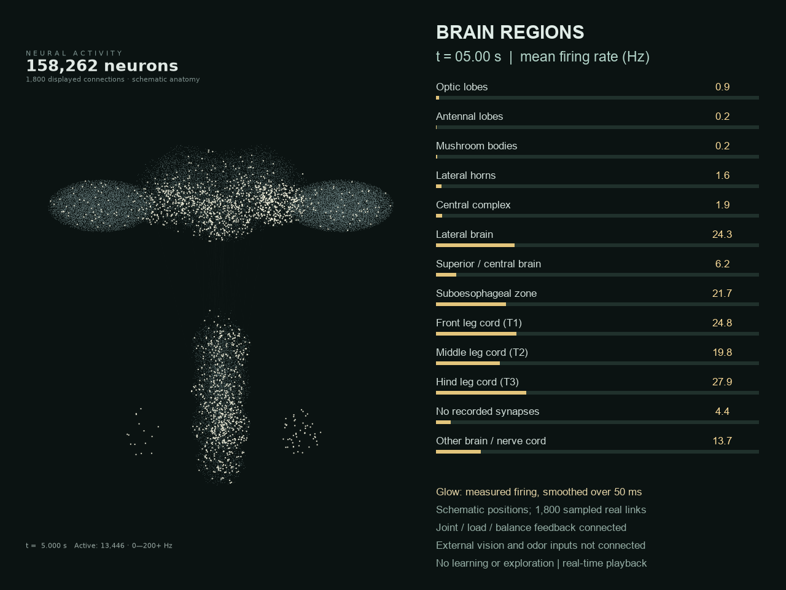
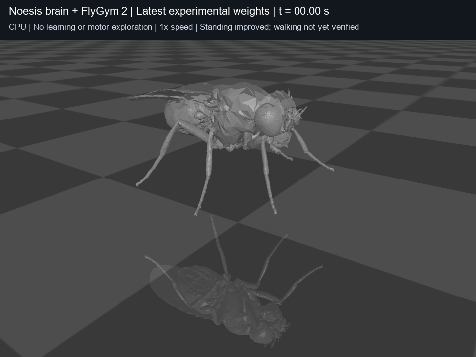
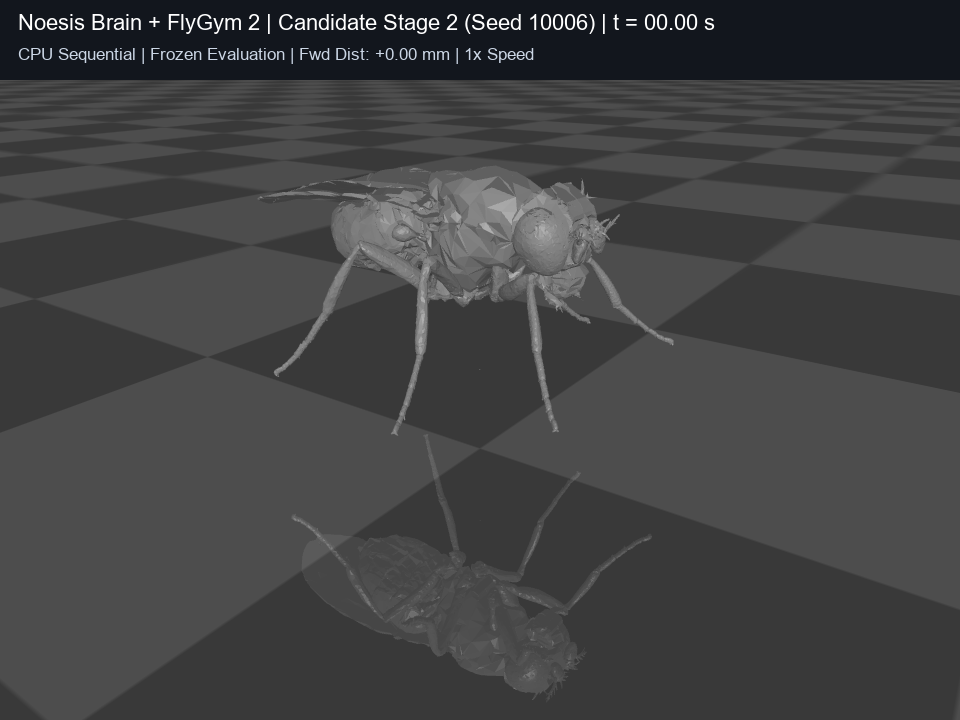

# גלריית התקדמות ויזואלית ומדיה – Project Noesis (FlyGym 2)

מסמך זה מרכז את כל שלבי ההתפתחות הוויזואליים והקינמטיים של הזבוב – החל מהפעילות המוחית והעמידה הראשונית, דרך הצעדים הראשונים, ועד לסנכרון תלת-הרגל (Tripod Gait).

---

## ציר הזמן ההתפתחותי (Evolutionary Timeline)

```
[שלב 1: עמידה ומוח]       ───>  [שלב 2: צעדי אחיזה לפנים]   ───>  [שלב 3: סנכרון רגליים והליכה]
• יציבה סטטית על 6 רגליים      • תחילת הנפה ודחיפה קדימה          • סנכרון שלשות רגליים (Tripod)
• פעילות נוירונלית שלמה       • התקדמות +2.58 מ"מ (10 שניות)     • זינוק של 148% בתיאום הרגליים
```

---

## 1. שלב 1: פעילות מוחית ועמידה יציבה (Standing Baseline)

בשלב זה המוח לומד לייצב את מרכז הכובד של הגוף מעל הקרקע, להפעיל את הנוירונים המוטוריים ב-VNC, ולמנוע נפילה או קריסה.


*תמונת הדמיה של קצבי הירי החשמליים (Firing Rates) לאורך 158,000 הנוירונים במוח הזבוב.*


*יציבה ראשונית בעמידה על הקרקע.*

### קובצי וידאו של שלב 1:
* 🧠 `neural-video-10s-20261023/brain-activity-10-seconds.mp4` – סרטון 10 שניות המציג את הפעילות החשמלית בזמן אמת של האונות, אזורי הראייה וה-VNC.
* 🎬 `video-current-10s-20261023/fly-10-seconds.mp4` – שמירה על יציבה סטטית ללא התקדמות קדימה.

---

## 2. שלב 2: צעדי אחיזה והתקדמות ראשונה לפנים (Gripped-Steps)

בשלב זה (מטרת v8), הזבוב מפסיק לקפוא במקום ומתחיל להניף רגליים ולדחוף לפנים תוך שיפור האחיזה בקרקע.


*הזבוב מייצר דחיפה אקטיבית לפנים עם יציבה מורמת.*

### מאפיינים פיזיקליים:
* **התקדמות קדימה:** **+2.58 מ"מ** לאורך 10 שניות סימולציה (+1.52 מ"מ בפרוב קפוא של 5 שניות).
* **הפחתת החלקה בקרקע:** שיפור של כ-**20%** באחיזת כפות הרגליים (Tarsus).
* **שיעור עמידה:** **96.9%** (יציבות גבוהה שעברה את שער העמידה).

### קובץ וידאו של שלב 2:
* 🎬 `video-candidate-10s-stage2/fly-10-seconds.mp4` – תיעוד של 300 פריימים ב-30 FPS.

---

## 3. שלב 3: סנכרון רגליים והליכה רציפה (Continuous Walking)

בשלב זה (מטרת v6), המוח מתחיל לסנכרן את שש הרגליים לפעולה בשלשות מתחלפות (תבנית Tripod קלאסית: 3 רגליים באוויר, 3 על הקרקע).


*תנועת הנפה דינמית של הרגליים הנגדיות.*

### מאפיינים פיזיקליים:
* **מדד תיאום חצובה (Tripod Coordination):** זינוק של מעל **148%** מ-0.05 ל-**0.141–0.160**.
* **תנועה קדימה:** **+1.056 מ"מ** לאורך 10 שניות.
* **דפוס רגליים:** מחזורי הרמה ודריכה מתחלפים (הנפה מובהקת של הרגליים האחוריות והקדמיות).

### קובץ וידאו של שלב 3:
* 🎬 `video-candidate-10s-stage3/fly-10-seconds.mp4` – תיעוד 10 שניות ב-30 FPS של הליכת החצובה.

---

## טבלת השוואת שלבים (Side-by-Side Comparison)

| פרמטר פיזיקלי | שלב 1: עמידה (Standing) | שלב 2: צעדי אחיזה (Gripped-Steps) | שלב 3: הליכה רציפה (Continuous) |
| :--- | :---: | :---: | :---: |
| **התקדמות קדימה (5 שנ')** | $-0.04\text{ מ"מ}$ (נסיגה לאחור) | **$+0.99$ עד $+1.52\text{ מ"מ}$** | **$+0.78$ עד $+1.69\text{ מ"מ}$** |
| **התקדמות בסרטון (10 שנ')** | $0.00\text{ מ"מ}$ | **$+2.58\text{ מ"מ}$** | **$+1.06\text{ מ"מ}$** |
| **תיאום חצובה (Tripod Score)** | $0.035$ (ללא סנכרון) | $0.055$ (צעדים ראשוניים) | **$0.141$ עד $0.160$ (זינוק בסנכרון)** |
| **שיעור החלקה בקרקע** | $2.40\text{ mm/s}$ | **$1.92\text{ mm/s}$ (-20%)** | $2.91\text{ mm/s}$ |
| **דפוס תנועה עיקרי** | עמידה במקום | צעידה אקטיבית לפנים | הנפת רגליים מתחלפת דינמית |
