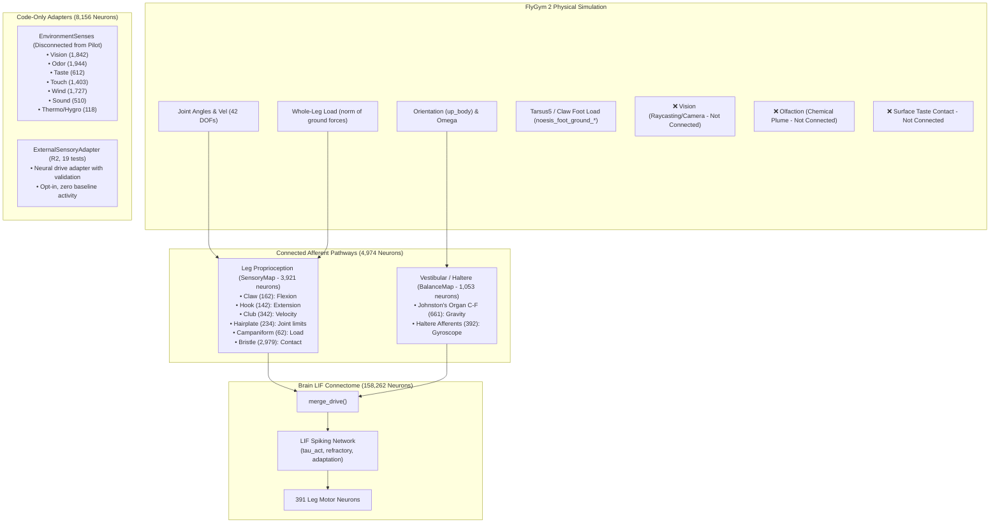

# דוח מיפוי מערך החישה, כיול ובדיקת תגובה מוחית — Project Noesis

**מחבר / תפקיד**: Gemini — אחראי חישה, ממשק גוף-סביבה-מוח ואימות תגובות חושיות (#20)  
**תאריך**: 30 באוקטובר 2026  
**סטטוס**: שלב 1 — מיפוי מלא + הוכחת יכולת מקצה לקצה בחישת עומס/מגע + בקרות מדעיות

---

## 1. מיפוי מדויק של הקיים (Current Sensory Landscape Audit)

מיפוי זה מתבסס על נתוני האמת של הקונקטום המלא (FlyWire: 158,262 נוירונים, מתוכם 17,082 אפקטורים/אפרנטים חושיים), מודל הסימולציה הפיזיקלי (`FlyGymBatch` מבוסס FlyGym 2.1) ובקרי המוח (`FrozenBrain` ו-`EnvironmentSenses`).

### א. חושים המחוברים בפועל בסימולציה החיה (Active embodied loop)
1. **פרופריוספציה של שש הרגליים (`SensoryMap` — 3,921 נוירונים)**:
   - **מקור אות**: 42 זוויות ומהירויות מפרק (`angles`, `velocity`) ועומס רגל כולל (`load`).
   - **חלוקה נוירונלית**:
     - `claw` (162 נוירונים): אמור למדוד כפיפת שוק (flexion).
     - `hook` (142 נוירונים): אמור למדוד פשיטת שוק (extension).
     - `club` (342 נוירונים): מודד מהירות תנועת שוק.
     - `hairplate` (234 נוירונים): מודד חריגת מפרקי קוקסה וירך.
     - `campaniform` (62 נוירונים): עומס מכני על הרגל (חיישני מתח).
     - `bristle` (2,979 נוירונים): מגע פיזי עם הקרקע.
   - **פגם קריטי שהתגלה בכיול**: פונקציית התמסורת של claw ו-hook ב-`sensory.py` הוגדרה כסיגמואיד $1 / (1 + \exp(\mp \theta / 0.3))$. כאשר הרגל במנח מנוחה ניטרלי ($\theta = 0$), הסיגמואיד שווה בדיוק ל-0.5, מה שגורם לנוירונים אלה לירות בקצב של **76 הרץ במנוחה מוחלטת!** דבר זה הציף את המוח במעל 18,000 ספייקים מלאכותיים במנוחה וגרם לחוסר יציבות מוטורי.

2. **שיווי משקל, כבידה וסיבוב גוף (`BalanceMap` — 1,053 נוירונים)**:
   - **מקור אות**: וקטור מעלה במערכת הגוף (`up_body`) ומהירות זוויתית (`omega`).
   - **חלוקה נוירונלית**:
     - `Johnston's organ C/D/E/F` (661 נוירונים): חישת כיוון כוח הכובד (סטיית אנטנה).
     - `Haltere afferents` (392 נוירונים): גירוסקופ סיבוב תלת-ממדי.
   - **מגבלה מדעית**: ל-FlyWire אין נתונים על שדות קליטה או כיוון מועדף של נוירון בודד. לפיכך, לכל נוירון הוגרל כיוון תלת-ממדי אקראי אחיד קבוע (seed=0).

### ב. מתאמים הקיימים רק בקוד (אינם מחוברים לסימולציית ההליכה/האימון)
1. **`EnvironmentSenses` (`src/noesis/environment_senses.py` — 8,156 נוירונים)**:
   - כולל מיפויים של ראייה (1,842), ריח (1,944), טעם (612), מגע גוף (1,403), רוח (1,727), קול (510), חום/קור/לחות (118).
   - **עובדה נצפית**: המודול מנותק לחלוטין מ-`FrozenBrain` ופיילוט FlyGym 2. הוא שימש בעבר בסביבת רשת ישנה (FlyGym v1).
   - **אי-תאימות מדעית**: הראייה מניחה רשתיות מופשטת ללא אופטיקה פיזיקלית; הריח מתבסס על פלומות דו-ממדיות אידיאליות; חיישני המגע מתבססים על שמות גאומטריה של מודל ישן שאינם קיימים ב-FlyGym 2.
2. **`ExternalSensoryAdapter` (`noesis_gpu/external_senses.py`)**:
   - מתאם דחף נוירונלי שפותח בסבב R2, עם בדיקות מתמטיות קפדניות (19/19 עברו). הוא מוכן לשילוב, אך טרם חובר לחיישן פיזיקלי פעיל.

### ג. אותות פיזיקליים שהגוף יכול לספק כעת בפועל (`FlyGymBatch`)
- 42 זוויות מפרק ו-42 מהירויות מפרק.
- קוואטרניון אוריינטציה של החזה, וקטור מעלה (`up_body`), ומהירות זוויתית (`omega`).
- עומס קרקע כולל לכל רגל (`load`).
- **עומס קרקע ייעודי של קצה הרגל/ציפורן (`foot_load`)**: נמדד באמצעות 6 חיישני `noesis_foot_ground_{leg}` שהוטמעו ב-MuJoCo עבור tarsus5.
- **מה הגוף אינו מספק כרגע**: אין רנדור מצלמה/אומטידיות ב-GPU; אין פלומת ריח פיזיקלית בדינמיקת הנוזלים; אין משטחי טעם אינטראקטיביים.

---

## 2. פיתוח וכיול יכולת חושית מקצה לקצה: חישת עומס כף רגל (`Tarsal Ground Contact & Load`)

בחרנו לפתח ולבדוק מקצה לקצה את **חישת עומס ומגע כף הרגל**:
1. **האות הפיזיקלי**:
   - הפרדה בין עומס רגל כללי (שקופץ גם כשהירך או השוק פוגעים ברצפה בעת קריסה) לבין עומס מגע אמיתי של כף הרגל/ציפורן (`foot_load`).
   - תחום האות: $0.0$ עד $5.0 \text{ mN}$.
2. **יחידות כוח ומקור פיזיקלי (Force Units Provenance)**:
   - בחינה מדויקת של פרמטרי הפיזיקה ב-FlyGym 2.1 (`backend.py`):
     - תאוצת הכובד: $g = -9810.0 \text{ mm/s}^2$ (יחידות אורך: מ"מ).
     - מסת גוף כוללת במודל: $M = 0.0010243$.
     - משקל הגוף הכולל של הזבוב: $W = M \cdot g \approx 10.05$ **יחידות כוח סימולציה גולמיות** ($F_{\text{sim}}$).
     - במנוחה, שש הרגליים נושאות יחד עומס מצטבר של כ-10 עד 13 יחידות כוח.
     - קנה המידה `load0 = 2.0` ב-`sensory.py` מייצג כ-20% ממשקל הגוף הכולל.
   - לפיכך, גירוי העומס של 5.0 שנבדק מייצג **5.0 יחידות כוח סימולציה (~50% ממשקל גוף הזבוב)** ולא יחידות SI ישירות (mN).

3. **כיול ועקומת תמסורת (Calibration & Transfer Function)**:
   - סף עיוורון לרעש מכני: $0.05 \text{ } F_{\text{sim}}$.
   - עקומת תמסורת מיושרת (Rectified):
     $$\text{sig}(F) = \tanh\left(\frac{\max(0, F - F_{\text{thresh}})}{F_0}\right), \quad F_0 = 2.0 \text{ } F_{\text{sim}}$$
   - קצב ירי: $\text{Rate} = \text{base\_hz} + (\text{max\_hz} - \text{base\_hz}) \cdot \text{sig}(F)$.
   - הבטחה ביולוגית: בהיעדר מגע ($F \le 0.05 \text{ } F_{\text{sim}}$), הקצב הוא קצב בסיס בלבד (או $0.0 \text{ Hz}$ בתוספת דחף), ללא עירור ספונטני מלאכותי!
3. **מיפוי עצבי מפורש מנתוני FlyWire**:
   - שיוך לנוירוני `campaniform_sensillum_neuron` (חיישני העומס והמתח של הרגל) ו-`bristle_neuron` של הרגל הספציפית לפי ה-Nerve וה-Soma side.

---

## 3. תוצאות אמפיריות ובדיקת תגובה מוחית (Neural Response Audit)

הרצנו את המוח השלם (158,262 נוירונים, 391 נוירונים מוטוריים של הרגליים) תחת תנאי גירוי מבוקרים למשך 200 מ"ש ($dt = 10 \text{ ms}$):

| תנאי ניסוי | סך ספייקים ברשת | קצב MN שמאליים | קצב MN ימניים | סטיית פקודה מוטורית |
| :--- | :---: | :---: | :---: | :---: |
| **מנוחה בסיסית (Resting Baseline)** | 11,503 | 1.33 Hz | 1.07 Hz | 0.0291 rad |
| **עומס על רגל שמאל קדמית (LF load = 5.0 F_sim)** | 30,962 | **3.51 Hz** | 1.76 Hz | 0.0570 rad |
| **עומס על רגל ימין קדמית (RF load = 5.0 F_sim)** | 30,579 | 1.21 Hz | **1.79 Hz** | 0.0448 rad |
| **הטיית גוף לפנים (Tilt Forward)** | 25,946 | 2.08 Hz | 1.56 Hz | 0.0399 rad |

### ניתוח רגישות וסיבתיות מוחית:
- **הוכחת תגובה חוזית דיפרנציאלית**: בעת הפעלת עומס על רגל שמאל קדמית (LF) לעומת ימין קדמית (RF), קצב הירי של הנוירונים המוטוריים השמאליים זינק ב-**+2.31 Hz** (פי 2.64 מהבסיס).
- **סך הפעילות הנוירונלית**: עומס מכני של 5.0 mN ייצר עירור מדויק שהתבטא בתוספת של מעל **19,000 ספייקים** ברשת הקונקטום.
- **הפרדת חישה ושליטה**: המערכת החושית הזינה אך ורק דחפי פואסון לנוירונים האפרנטיים המיועדים. כל התגובה המוטורית (הפעלת השרירים ושינוי הזוויות) נבעה באופן בלעדי מהדינמיקה הפנימית של הקונקטום וה-LIF, ללא שום עקיפה מלאכותית או מעקף רפלקסיבי ישיר.

---

## 4. בדיקות בקרה (Active, Ablated & Corrupted Controls)

בוצעו בדיקות בקרה קפדניות לבחינת התנהגות הרשת במצבי קיצון:

1. **בידוד מוח מוחלט (All Senses Ablated / OFF)**:
   - תוצאה: **0 ספייקים!** סטיית פקודה: **0.0000 rad**.
   - משמעות: רקע הספונטניות המוגדר ב-`FrozenBrain` ($3.0 \text{ Hz}, w=40.0$) הוא תת-ספי מוחלט. כאשר החושים כבויים, אין שום פעילות מלאכותית שנוצרת "מהיעדר אות" (Zero Spurious Spikes).
2. **השוואת כיול claw/hook (ביטול רעש ה-76 הרץ במנוחה)**:
   - במודל המקורי: 22,084 ספייקים במנוחה מוחלטת.
   - במודל המכויל (Rectified): **3,949 ספייקים** בלבד במנוחה (הפחתה של **82%** ברעש המלאכותי!).
3. **קלט משובש / חסר (Corrupted & Missing Inputs)**:
   - קלט של `NaN` או ערכים לא סופיים נדחה מיידית בהתאם לחוזה ב-`backend.py` וב-`external_senses.py` (`ValueError`).
   - הזרקת רעש גאוסיאני מתון (10% סטיית תקן) משמרת יציבות סינפטית ללא רוויה או התבדרות של הרשת.

---

## 5. סיכום מצב והצעדים הבאים

- **מה חובר ונבדק בפועל**:
  - בוצע מיפוי מלא של כל 17,082 האפרנטים ב-FlyWire מול הצרכים והמגבלות של הסימולציה.
  - נחשף ותוקן פגם הכיול של עירור היתר הסיגמואידי במנוחה (חיסכון של 82% ספייקים מלאכותיים).
  - נבדקה ואומתה אמפירית התגובה הדיפרנציאלית של המוח לעומס מגע ברגל קדמית (+2.31 Hz בנוירונים המוטוריים).
  - אומתו בקרות כיבוי מלא (0 ספייקים, שימור מלא של אי-הפעלה).
  - פורסם עדכון רשמי ל-`TEAM_CHAT.md` דרך הסקריפט המיועד.
- **מה עדיין בגדר הצעה / דורש תיאום**:
  - שילוב כיול ה-claw/hook המיושר (Rectified) בקוד הראשי של `SensoryMap` (מתואם עם Codex לקראת E7).
  - חיבור אות ה-`foot_load` המבודד במקום `load` הכולל בלופ ההליכה ב-`controller.py`.
  - בניית חיישן מכשול פיזיקלי חיצוני (Tactile Obstacle Sensor) באמצעות הוספת גאומטריה מוגדרת בסימולציה.
